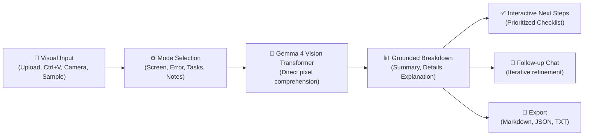

# ClarityLens 🔍

> **"See the problem. Find the next step."**

ClarityLens is a multimodal visual intelligence suite powered by **Gemma 4** (`gemma-4-26b-a4b-it`), built for the **Hacktoberfest Hack Day x Oracle Kolkata** under the **Best Use of Gemma 4** category.

Instead of a generic chatbot or static OCR pipeline, ClarityLens uses Gemma 4's native multimodal vision-language weights to directly interpret visual artifacts — developer terminal crashes, confusing cloud IAM dialogs, hackathon briefs, or handwritten study notes — converting them into grounded explanations, interactive checkable next steps, and continuous follow-up guidance.

---

## 🌟 The Core Capabilities

ClarityLens provides four purpose-engineered multimodal intelligence modes:

1. **Explain this screen**: Understand unfamiliar software interfaces, cloud security dialogs, or confusing notices before taking action.
2. **Fix this error**: Parse developer terminal crashes, stack traces, and build errors into beginner-friendly explanations with safe recovery commands.
3. **Turn this into tasks**: Read assignment briefs, project requirements, or event notices and extract discrete deliverables, deadlines, and prioritized checklists.
4. **Understand these notes**: Explain photographed handwritten notes, whiteboard diagrams, or study slides, deciphering mathematical formulas and generating active-recall checklists.

---

## 🚀 Advanced Features

- 📋 **Global Clipboard Paste (`Ctrl+V`)**: Press `Ctrl+V` anywhere in the workspace to instantly load a screenshot from your clipboard (Snipping Tool, Cmd+Shift+4, PrintScreen).
- 📷 **Direct Webcam / Camera Snapshot**: Take a photo directly within the application for physical study notes, whiteboards, or hardware screens.
- 💬 **Interactive Follow-up Chat with Visual Context**: Ask questions, request specific code fixes, or explore alternative solutions with continuous access to the image and analysis context.
- 🎯 **Checkable Next Steps with Urgency Filtering**: Interactive task checklist with real-time completion tracking (`% completed`), priority filters (High, Medium, Low), and one-click command copying.
- 📥 **Multi-Format Export**:
  - **GitHub Flavored Markdown (`.md`)**: Beautifully formatted reports with checkboxes, badges, and code blocks for GitHub issues/PRs.
  - **Structured JSON (`.json`)**: Raw schema export for pipeline automation.
  - **Plain Text (`.txt`)**: Clean terminal-style export.
- 🔄 **Resilient Model Architecture**:
  - Primary Target: `gemma-4-26b-a4b-it` (26B vision-language transformer).
  - High-Speed Fallback: `gemini-2.5-flash` and `gemini-2.0-flash` for zero-downtime reliability if quotas are constrained.
  - Transparent Model Indicator: Clearly marks which model processed the visual artifact.
- 📂 **Local Session History**: All analyses are preserved in local storage with one-click restore and thumbnail previews.
- 🖥️ **Studio Mode vs Showcase Landing**: Seamless toggle between an editorial showcase and a dedicated, focused Studio Workspace.
- 🔑 **Flexible API Key Management**: Uses server `.env` key by default, with optional client-side override in the UI for instant testing.

---

## 🔄 The Multimodal Workflow



---

## 🧠 Model Architecture & Grounding Directives

ClarityLens communicates with the official Google Gen AI SDK (`@google/genai`):

- **Primary Model**: `gemma-4-26b-a4b-it`
- **Fallback Models**: `gemini-2.5-flash`, `gemini-2.0-flash`
- **Sampling Temperature**: `0.2` (optimized for strict visual grounding and anti-hallucination)
- **Zero Client Secrets**: Browser client communicates with the server-side Express proxy (`POST /api/analyze` and `POST /api/chat`), ensuring keys are never exposed in client bundles.
- **Strict Grounding Rules**: Prompt guardrails mandate that unseen stack frames or ambiguous text are flagged under **"Things to verify"** rather than guessed.

---

## 💻 Getting Started

### Prerequisites

- Node.js 18+, 20+, or 22+
- A Google Gen AI / Gemini API key with access to Gemma 4 / Gemini models

### Installation & Setup

1. **Clone the repository**:
   ```bash
   git clone https://github.com/your-username/claritylens.git
   cd claritylens
   ```

2. **Install dependencies**:
   ```bash
   npm install
   ```

3. **Configure Environment Variables**:
   Copy `.env.example` to `.env`:
   ```bash
   cp .env.example .env
   ```
   Add your Gemini API key:
   ```env
   GEMINI_API_KEY="your-gemini-api-key"
   PORT=3000
   ```
   *(Note: If you don't have an API key configured on start, you can enter one directly in the UI or test with the pre-seeded interactive sample scenarios!)*

4. **Run the Development Server**:
   ```bash
   npm run dev
   ```
   Open your browser at `http://localhost:3000`.

5. **Typecheck & Production Build**:
   ```bash
   npm run lint
   npm run build
   npm start
   ```

---

## 📂 Project Structure

```
├── .env.example              # Environment variables template
├── index.html                # Entry HTML with typography and metadata
├── metadata.json             # AI Studio applet metadata & capabilities
├── package.json              # Full-stack dependencies & scripts
├── server.ts                 # Express full-stack backend with Gemma 4 & chat proxy
├── src/
│   ├── App.tsx               # Main application container & view manager
│   ├── main.tsx              # React DOM entry point
│   ├── index.css             # Tailwind CSS imports & theme base layers
│   ├── types/
│   │   └── clarity.ts        # TypeScript schemas for modes, results, and steps
│   ├── utils/
│   │   └── exportUtils.ts    # Markdown, JSON, and text export generators
│   ├── data/
│   │   └── samples.ts        # 4 high-fidelity SVG sample artifacts & demos
│   └── components/
│       ├── Navbar.tsx        # Top navigation with Studio / Showcase mode toggle
│       ├── Hero.tsx          # Editorial hero with product preview
│       ├── Workspace.tsx     # Main interactive multimodal studio workspace
│       ├── ResultView.tsx    # Grounded result view with checkable steps & follow-up chat
│       ├── CameraModal.tsx   # Device webcam snapshot capture modal
│       ├── HistoryDrawer.tsx # Recent analyses history drawer
│       ├── ApiKeyModal.tsx   # Custom API key settings modal
│       ├── ImageZoomModal.tsx# High-resolution image inspection modal
│       ├── TransformationSection.tsx # Noise to clarity pipeline showcase
│       ├── ModesSection.tsx  # 4 intelligence modes showcase
│       ├── ArchitectureSection.tsx   # Output pillars & Gemma 4 specs
│       ├── FaqSection.tsx    # Frequently asked questions accordion
│       └── Footer.tsx        # Licensing, attribution, and quick links
└── tsconfig.json             # TypeScript configuration
```

---

## ⚖️ Licensing & Attribution

- **Application Code**: Licensed under the [MIT License](LICENSE).
- **Gemma Model Terms**: Google Gemma model weights and hosted access are governed by the [Gemma Terms of Use](https://ai.google.dev/gemma/terms).
- **Hackathon Attribution**: Developed for **Hacktoberfest Hack Day x Oracle Kolkata** — Best Use of Gemma 4.
- **Platform Credit**: Built with Google AI Studio and `@google/genai`.
